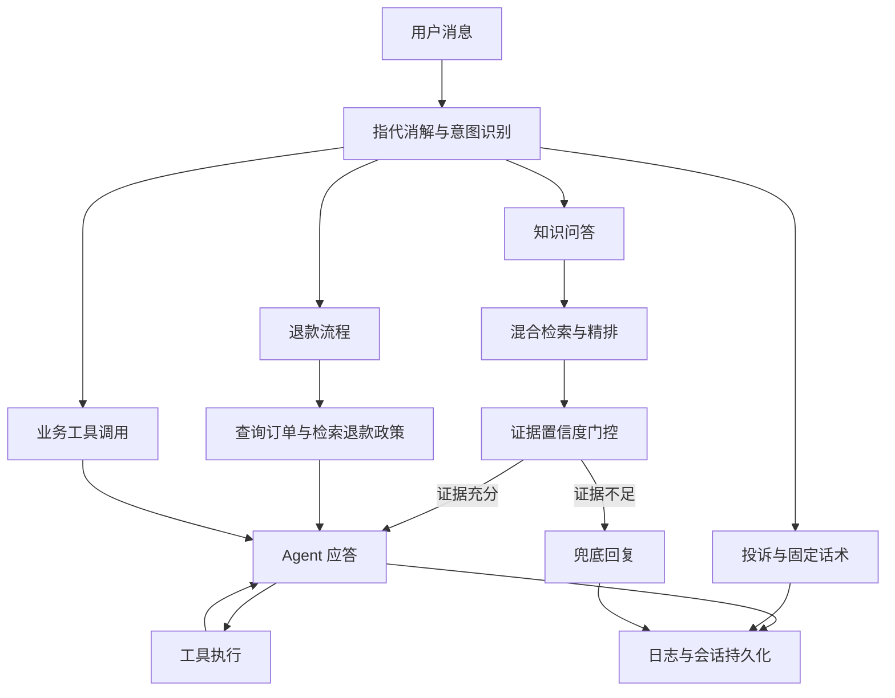

# 电商智能客服系统

面向电商售后场景的智能客服系统，采用确定性 Workflow 与 Agent 混合架构，提供政策问答、订单与物流查询、退款流程、投诉处理和人工兜底。系统同时包含知识库管理、数据飞轮、调用观测与主题分类服务。

## 技术栈

Python 3.12+ · FastAPI · LangGraph / LangChain · SQLAlchemy / MySQL · Milvus · MCP · Langfuse · Transformers · ONNX Runtime。

## 对话架构



## 核心能力

| 模块 | 实现 |
| --- | --- |
| 混合检索 | BGE-M3 向量召回与 BM25 关键词召回，经过 RRF 融合、BGE-Reranker 精排，结合 Query 改写与多子问题检索 |
| 证据门控 | 使用 Top1 精排分、有效证据数、Top1/Top2 分差与关键条款命中四个信号计算置信度，在生成前决定进入 Agent 或兜底回复 |
| 业务编排 | LangGraph 编排意图分流、退款子流程、Agent 与工具循环；通过 interrupt/resume 支持人工确认与恢复 |
| 上下文管理 | 结合近期消息窗口、异步摘要与工具结果处理组织对话上下文 |
| 工具系统 | 内置工具注册、MCP 动态发现、统一执行引擎与工具审计 |
| 数据飞轮 | 收集知识缺口，批量标准化与语义查重，进入人工审核队列后写回知识库 |
| 主题分类 | RoBERTa 多标签分类，覆盖 17 类主题；支持训练、阈值扫描、ONNX 导出与旁路批量推理 |
| 可观测性 | Langfuse 调用追踪、Token 与成本统计、检索评测及评测趋势记录 |

## 评测结果

检索评测集共 300 题：政策、型号、口语、跨文档与不可作答五个桶，每桶 60 题。下表统计其中 240 道可作答题，完整记录见 [检索评测报告](data/ch04/reports/rag_eval.json)。

| 检索策略 | Recall@5 | MRR |
| --- | ---: | ---: |
| 向量检索 | 97.3% | 0.840 |
| BM25 | 89.0% | 0.774 |
| 混合检索 | 94.2% | 0.815 |
| 混合检索 + 精排 | 98.3% | 0.894 |

生成答案覆盖度约 97%，评估方式为模型判分，详见 [评测文本报告](data/ch04/reports/rag_eval.txt)。

主题分类器在 161 条留出测试样本上，阈值为 0.45，micro-P 为 0.9719、micro-R 为 0.9558、micro-F1 为 0.9638。各类指标和混淆矩阵见 [分类器评测报告](data/ch10/reports/eval_report.md)。

## 本地启动

依赖 Python 3.12+、uv、Docker Compose 和 make。以下命令使用 Bash；Windows 可在 Git Bash 或 WSL 中执行。

```bash
cp .env.example .env
uv sync
# 配置 .env 后启动数据库与向量检索服务
docker compose up -d
make seed
make dev
```

启动前填写 `.env` 中的聊天、嵌入和重排模型配置，以及 `MYSQL_ROOT_PASSWORD`、`MINIO_ROOT_USER`、`MINIO_ROOT_PASSWORD`、`DATABASE_URL` 和 `TEST_DATABASE_URL`。数据库 URL 中的密码需做 URL 编码，测试数据库与应用数据库分开配置。

首次使用 RAG 时构建知识库：

```bash
make kb-build
make kb-vectorize
```

启用 Langfuse 时配置对应环境变量，三组 S3 凭据与 Langfuse 所用 MinIO 保持一致。部署细节见 [部署说明](DEPLOY.md)。

| 地址 | 功能 |
| --- | --- |
| `http://localhost:8000/` | 聊天 |
| `http://localhost:8000/kb` | 知识库录入 |
| `http://localhost:8000/review` | 飞轮待审队列 |
| `http://localhost:8000/observability` | 观测与成本 |
| `http://localhost:8000/topics` | 主题分布 |
| `http://localhost:8000/acceptance` | 分类器验收 |

## 评测与训练命令

```bash
make test                  # 测试，按配置准备独立测试数据库
make eval-rag              # 四策略检索与生成评测
make calibrate-confidence  # 置信度阈值校准
make flywheel              # 知识缺口标准化与查重
make ch10-train            # 主题分类器训练
make ch10-eval             # 分类器评测
make ch10-export           # ONNX 导出与一致性校验
```

检索、生成和训练命令各自需要对应的数据库、模型服务或训练依赖，完整目标见 `make help`。

## 代码结构

```text
app/api/        HTTP 与流式接口
app/graph/      对话状态图、节点与路由
app/core/       检索、精排、意图、置信度、摘要与飞轮
app/kb/         知识切块、嵌入、入库与问答挖掘
app/tools/      内置工具、MCP 与执行引擎
app/db/         数据模型与仓储
app/static/     聊天与管理页面
mcp_servers/    物流与售后 MCP 服务
scripts/        离线评测、数据处理与分类器训练
sql/            建表与迁移
tests/          自动化测试
```
